<p align="center">
  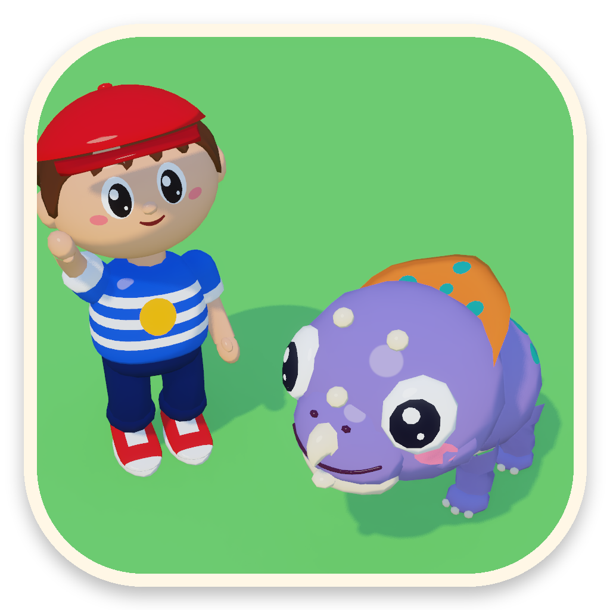
</p>

<h1 align="center">Tommy's Dino Zoo</h1>

<p align="center">
  A gentle dinosaur farm for children (about 5 to 15) and for anyone who wants a calm game.<br>
  macOS and Windows · keyboard or gamepad · English and Spanish
</p>

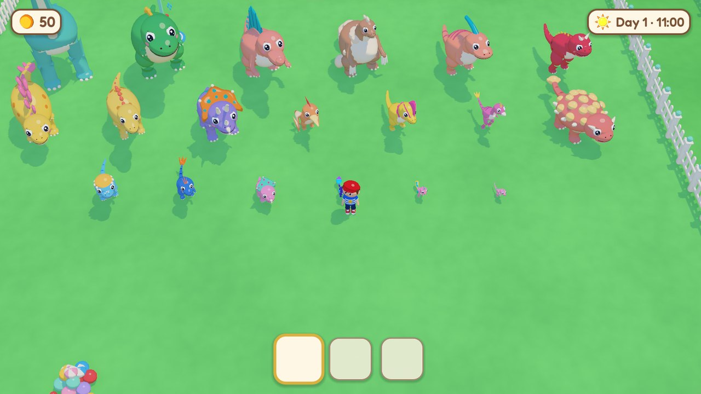

Jurassic Park turned out fine, and small. Tommy looks after a little farm of
cartoon dinosaurs: he feeds them, brushes them, plays ball with them, scoops
their poop, grows ferns and pumpkins, hatches eggs and watches the babies
grow up.

**It is a relaxing game with nothing to lose.** There are no lives, no
enemies, no timers that punish and no game over. A dinosaur never gets ill or
runs away: one that nobody has looked after just sits looking a little glum
until someone gives it a cuddle. Everything a child needs to know is shown
with a picture before they press a button, so it can be played before being
able to read.

- **20 dinosaurs**, real species drawn as cartoons, each at three ages (baby,
  youngster, grown-up) and with its own egg: triceratops, stegosaurus,
  ankylosaurus, brachiosaurus, parasaurolophus, pachycephalosaurus, iguanodon,
  protoceratops, gallimimus, therizinosaurus, T. rex, velociraptor,
  spinosaurus, dilophosaurus, carnotaurus, compsognathus, microraptor,
  pteranodon, archaeopteryx and a plesiosaur in the lagoon. Each has a real
  fact in the dino album.
- **Six habitats** to open with coins: the meadow, the tall forest, the lagoon,
  the canyon, the cliff and Rex Valley, each with its own trees, rocks, toys
  and food plants.
- **Neighbours**: Doctor Nat sells eggs and tells dinosaur facts, Uncle Juampi
  explains how to do the day's missions, Grandpa Juan runs the shop stand,
  and visiting children ask for small favours and leave coins.
- Three small missions a day, a vegetable garden, fishing, digging for
  treasure, a wardrobe for Tommy, a backpack for a fourth pocket, and a day
  that goes from sunrise to a lantern-lit night with its own music.

| | |
| --- | --- |
| 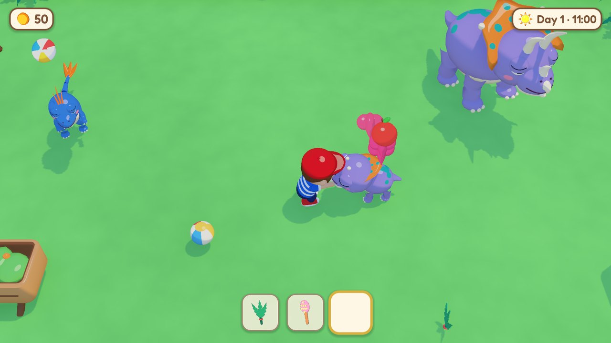 | 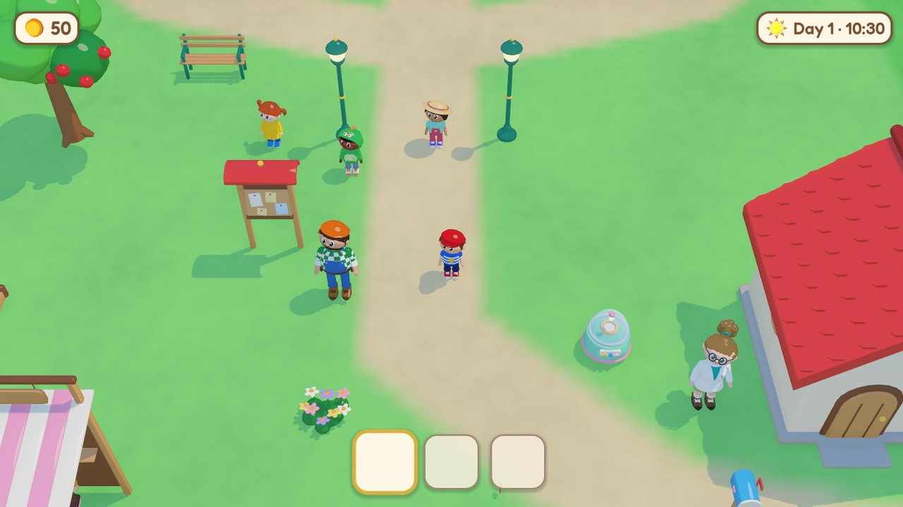 |
| Petting a baby triceratops: hearts, and a bubble saying it's hungry | The yard: Uncle Juampi, Doctor Nat and visiting kids |
| 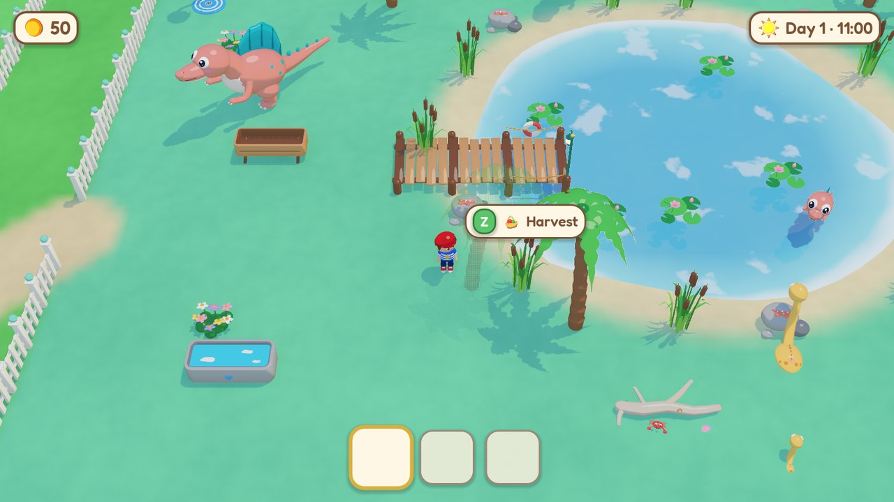 | 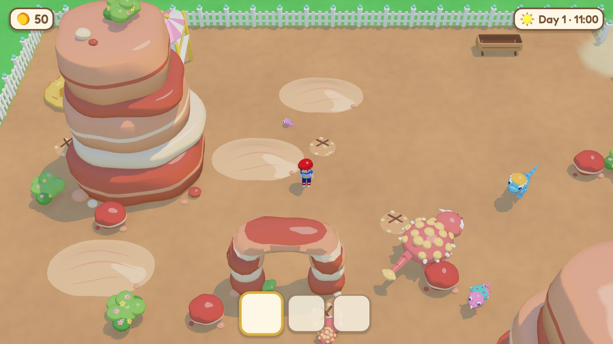 |
| The lagoon: a pier, reeds and lily pads; fish with the rod | The canyon: mesas, a rock arch and spots to dig |
| 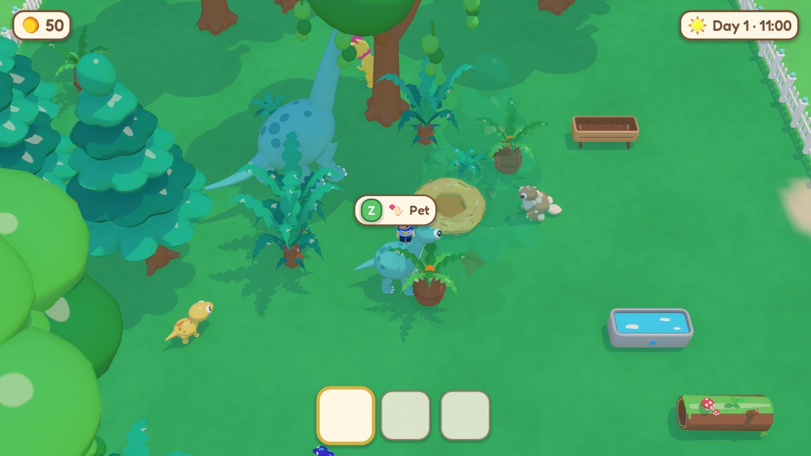 | 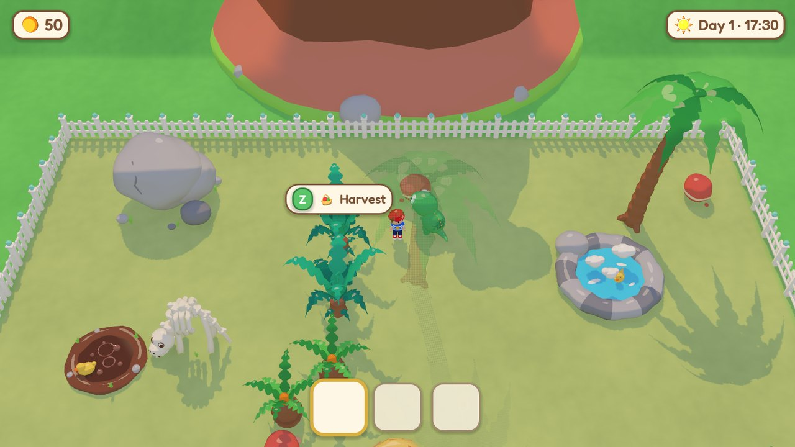 |
| The tall forest, where the brachiosaurus eats from the treetops | Rex Valley: a hot spring with a rubber duck, a fossil and a friendly volcano |
| 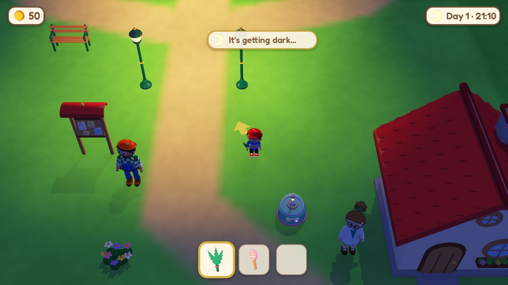 | 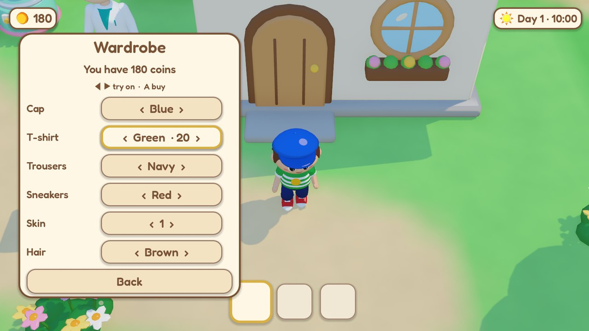 |
| Night: lanterns come on and the dinos go to their nests | The wardrobe: try colours on, buy them with A |

## For parents

Everything here is under **Settings → For parents**, which is guarded by a
grown-up question (a multiplication) or by a 4-digit PIN if you set one.

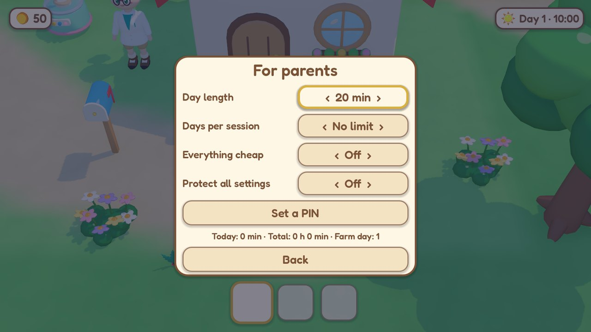

- **Day length** — 15, 20, 30, 45, 60 or 90 minutes of real time per game
  day. When the day ends Tommy yawns, the game saves by itself, shows a little
  summary and says *See you tomorrow!*; going on takes a button press, which
  makes a natural place to stop.
- **Days per session** — no limit, or 1, 2, 3 or 5 game days. When they are
  used up a calm *Time for a rest!* card appears with **Quit**; carrying on
  needs the grown-up question or the PIN.
- **Play time** — minutes played today, total time played, and the farm's day.
- **Everything cheap** — every price divided by ten, so a young child can have
  almost everything without saving up.
- **PIN** — set, change or remove a 4-digit PIN (it can be typed or entered
  with the gamepad). Forgot it? The grown-up question resets it.
- **Protect all settings** — when on, the whole Settings menu asks for the PIN.

## Accessibility

**Settings → Accessibility** (no gate):

- **Text size** — normal, large or extra large; the whole interface scales.
- **Read aloud** — the system voice reads the action bubbles, messages,
  dialogues and the end-of-day summary.
- **Run automatically** — turn off for a child who should always walk.
- **Miniature blur** — the tilt-shift blur at the top and bottom of the
  screen can be turned off.
- **Camera flash** — the white flash of the photo camera can be turned off.
- **Gamepad rumble** — a little buzz on happy moments, on or off.

**Settings → Game** has the camera distance (very close to far), the language,
music and sound volumes, the guide arrow that points at the dinosaur that
needs care, and full screen.

## Controls

| | Keyboard | Gamepad |
| --- | --- | --- |
| Walk (hold to run) | arrows or WASD | left stick or d-pad |
| **A** — do what the bubble shows | Z, Space or Enter | A / ✕ |
| **B** — next pocket · hold to drop | X | B / ◯ |
| Menu | Esc | Start / Options |
| Menus | arrows and A, or the mouse | d-pad and A |

Tommy has three pockets (four with the backpack). What is in the active one is
in his hand, and **A** uses it on whatever is in front of him: food feeds, the
brush brushes, the ball plays — or flies when thrown, and some dinosaurs bring
it back — the shovel scoops and digs, the watering can waters, the rod fishes.
With full pockets, **A** on something on the ground swaps it for what he is
holding.

## Download

The [releases](../../releases/latest) have a zip for each system:

- **macOS 11 or later** (Apple silicon and Intel): unzip and move
  *Tommy's Dino Zoo* to Applications. It is not notarised, so the first time
  right-click it and choose **Open** (or System Settings > Privacy & Security
  > **Open Anyway**).
- **Windows 10 or later**: unzip anywhere and run `TommysDinoZoo.exe`.
  SmartScreen may ask the first time: **More info** > **Run anyway**.

Farms and settings are saved in
`~/Library/Application Support/Godot/app_userdata/Tommy's Dino Zoo` (macOS) or
`%APPDATA%\Godot\app_userdata\Tommy's Dino Zoo` (Windows). There are three
farm slots.

## How it's made

Everything is generated from code; there are no hand-made assets.

- **Game**: [Godot 4.7](https://godotengine.org) and GDScript (`game/`).
- **Art**: every model is built by a Python script in Blender —
  `art/blender/tommy.py`, `npcs.py`, `dino_lib.py` with `species_*.py`,
  `props*.py`, `icons.py` — and exported as `.glb`. The game gives them all one
  soft cartoon shader (`game/shaders/toon.gdshader`); item and interface icons
  are rendered from the 3D models while the game runs.
- **Music and sounds**: synthesised with numpy (`tools/audio/`).
- **Content is data**: dinosaurs, items, furniture, habitats and the wardrobe
  are in `game/content/base/pack.json`, the farm layout in `map.json`
  (habitats laid out by `tools/gen_habitats.py`). An expansion is another
  folder in `game/content/` with its own `pack.json`, models and texts.
- **Languages**: `game/content/<pack>/lang/<locale>.po`. A new language is a
  set of `.po` files with an `X-Language-Name` header; Settings lists it by
  itself. `.po` files dropped in the save folder's `lang/` work too.

### Building

```bash
cd game && godot --headless --path . --import    # once, after cloning
godot --path game                                 # play
godot --headless --path game --export-release "macOS" ../dist/TommysDinoZoo-macOS.zip
```

GitHub Actions builds both zips on every push and publishes them on a `v*`
tag (`.github/workflows/build.yml`).

### Developer switches

After `--` on the command line: `--scene=res://scenes/main.tscn` (skip the
title), `--new`, `--state=res://dev/showcase.json`, `--at=x,z`, `--hour=h`,
`--fast=N`, `--zoom=z`, `--lang=es`, `--still`, `--coins=N`,
`--keys="up:0.5,a,menu"` (scripted input), `--open=show_parents`, `--trace`,
`--shot=out.png` with `--shot-after=s` or `--shot-after-keys=s`. The model
viewer is `--scene=res://scenes/viewer.tscn --models=tommy,trike_baby --anim=walk`.

## Licence

MIT (see [LICENSE](LICENSE)). The [Fredoka](https://github.com/hafontia/Fredoka-One)
font is under the SIL Open Font License (`game/assets/fonts/OFL.txt`).

---

### En castellano

| | |
| --- | --- |
| **Qué es** | Una granjita de dinosaurios tiernos para chicos (de 5 a 15 años, más o menos) o para jugar tranquilo. No se puede perder: no hay vidas, ni enemigos, ni reloj que castigue. |
| **Para padres** | En *Ajustes → Para padres* (protegido por una cuenta para grandes o un PIN de 4 números): duración del día (15 a 90 minutos), días por sesión con una pantalla de "¡Hora de descansar!", tiempo jugado hoy y en total, modo *Todo baratito* y proteger todos los ajustes. |
| **Accesibilidad** | Tamaño del texto, leer en voz alta, correr solo, desenfoque de maqueta, flash de la cámara y vibración del joystick. |
| **Controles** | Flechas o WASD para caminar, Z/Espacio (A) para lo que muestra el cartelito, X (B) para cambiar de bolsillo (mantener = soltar), Esc para el menú. También con joystick. |
| **Instalar** | Bajar el zip de *Releases*. En Mac, la primera vez abrirlo con clic derecho → *Abrir*. En Windows, si avisa SmartScreen: *Más información* → *Ejecutar de todas formas*. |
| **Idiomas** | Castellano e inglés; se agregan más con archivos `.po`. |
