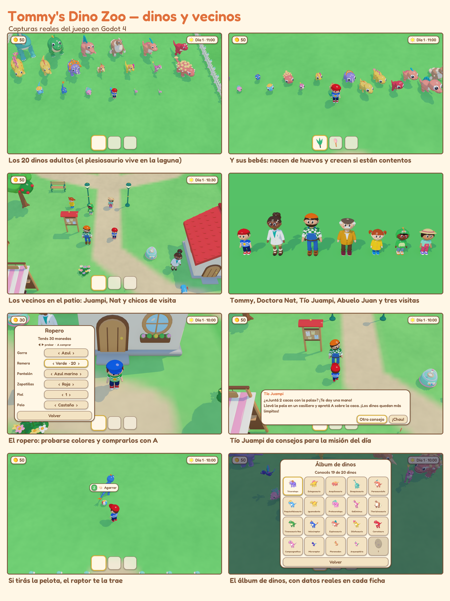

<p align="center">
  
</p>

<h1 align="center">Tommy's Dino Zoo</h1>

<p align="center">
  A cosy little dinosaur farm for kids (5 to 15) and for anyone who wants to play slowly.<br>
  For macOS and Windows. Keyboard or joypad.
</p>

<p align="center">
  
</p>

Jurassic Park turned out fine and small: Tommy looks after a farm of cartoon
dinosaurs. You feed them, brush them, play ball with them, scoop their poop,
grow ferns and pumpkins, hatch eggs and watch the babies grow up. **You can't
lose**: no dinosaur ever gets ill or runs away, there are no lives and no
timer. A dinosaur nobody has looked after just sits there looking a bit glum
until someone gives it a cuddle.

## For parents

- **The day lasts as long as you choose** (Settings → *Day length*: 15, 20,
  30, 45, 60 or 90 minutes). When it ends, Tommy yawns, the game saves by itself
  and shows a little summary of the day and "See you tomorrow!". Going on takes
  a button press: a natural place to stop.
- Settings also show how long the game has been played today.
- No reading needed to play: every action shows an icon before you press the
  button, and the dinosaurs show what they need in a bubble.
- Castellano and English. More languages are one `.po` file each (see below).

## Controls

| | Keyboard | Joypad |
|---|---|---|
| Walk (hold to run) | arrows or WASD | left stick / d-pad |
| **A** — do what the bubble says | Z, Space or Enter | A / ✕ |
| **B** — next pocket · hold to drop | X | B / ◯ |
| Menu | Esc | Start |

Tommy has three pockets. Whatever is in the active one is in his hand, and
**A** uses it on what is in front of him: food feeds, the brush brushes, the
ball plays (or gets thrown, and some dinos fetch it), the shovel scoops and
digs, the watering can waters, the fishing rod fishes.

## What's in it

- **20 dinosaurs**, real species as cartoons, each at three ages (baby,
  youngster, grown-up) and with its own egg: triceratops, stegosaurus,
  ankylosaurus, brachiosaurus, parasaurolophus, pachycephalosaurus,
  iguanodon, protoceratops, gallimimus, therizinosaurus, T. rex,
  velociraptor, spinosaurus, dilophosaurus, carnotaurus, compsognathus,
  microraptor, pteranodon, archaeopteryx and a plesiosaur in the lagoon.
- **Six habitats** to buy with coins — meadow, tall forest, lagoon, canyon,
  cliff and Rex Valley — each furnished with its own trees, rocks, toys and
  food plants.
- **Neighbours**: Doctor Nat (eggs and real dino facts), Uncle Juampi (tips
  for the day's missions), Grandpa Juan (the shop stand) and visiting kids
  who ask for things and leave coins.
- Daily missions, a garden, fishing, digging for treasure, a wardrobe for
  Tommy, a dino album and a day that goes from sunrise to lantern-lit night,
  with music for each part of the day.

## Install

Download the zip for your system from
[Releases](../../releases/latest):

- **macOS**: unzip and drag *Tommy's Dino Zoo* to Applications. The app is
  not notarised, so the first time open it with right-click → *Open*.
- **Windows**: unzip and run `TommysDinoZoo.exe`. SmartScreen may warn about
  an unknown publisher: *More info* → *Run anyway*.

Saves live in the system's app-data folder (macOS
`~/Library/Application Support/Godot/app_userdata/Tommy's Dino Zoo`,
Windows `%APPDATA%\Godot\app_userdata\Tommy's Dino Zoo`).

## How it's made

Everything is made from code, there are no hand-made assets:

- **Game**: [Godot 4.7](https://godotengine.org), GDScript, scenes as text
  (`game/`).
- **Art**: every model is built by a Python script in Blender
  (`art/blender/`: `tommy.py`, `npcs.py`, `dino_lib.py` + `species_*.py`,
  `props*.py`, `icons.py`) and exported as `.glb`. The game gives them all one
  soft cartoon shader (`game/shaders/toon.gdshader`). Item and UI icons are
  rendered from the 3D models at run time.
- **Music and sounds**: synthesised with numpy (`tools/audio/`).
- **Content is data**: dinosaurs, items, props, habitats and the wardrobe are
  in `game/content/base/pack.json`, the farm layout in `map.json` (habitats
  laid out by `tools/gen_habitats.py`). An expansion is another folder in
  `game/content/` with its own `pack.json`, models and texts.
- **Languages**: `game/content/<pack>/lang/<locale>.po`. A new language is
  new `.po` files with an `X-Language-Name` header; the Settings menu lists it
  by itself. `.po` files dropped in the save folder's `lang/` work too.

### Building

```bash
cd game && godot --headless --path . --import
godot --path game                                   # play
godot --headless --path game --export-release "macOS" ../dist/TommysDinoZoo-mac.zip
```

GitHub Actions builds both zips on every tag (`.github/workflows/build.yml`).

### Developer switches

After `--` on the command line: `--scene=res://scenes/main.tscn` (skip the
title), `--new`, `--state=res://dev/showcase.json`, `--at=x,z`, `--hour=h`,
`--fast=N`, `--zoom=z`, `--lang=es`, `--still`, `--keys="up:0.5,a,menu"`
(scripted input), `--trace`, `--shot=out.png` with `--shot-after=s` or
`--shot-after-keys=s`. The model viewer is `--scene=res://scenes/viewer.tscn
--models=tommy,trike_baby --anim=walk`.

## Credits

Made by Charlie Gallo with Claude. Font: [Fredoka](https://github.com/hafontia/Fredoka-One)
(SIL Open Font License, `game/assets/fonts/OFL.txt`).

---

### En castellano

| | |
|---|---|
| **Qué es** | Una granjita de dinosaurios tiernos para chicos de 5 a 15 años. No se puede perder. |
| **Para los padres** | En Ajustes se elige cuánto dura el día (15 a 90 minutos). Al terminar, Tommy se va a dormir, se guarda solo y hay que apretar un botón para seguir. |
| **Controles** | Flechas o WASD para caminar, Z/Espacio (A) para la acción del cartelito, X (B) para cambiar de bolsillo (mantener = soltar), Esc para el menú. Con joystick también. |
| **Instalar** | Bajar el zip de *Releases*. En Mac, la primera vez abrirlo con clic derecho → *Abrir*. En Windows, si avisa SmartScreen: *Más información* → *Ejecutar de todas formas*. |
| **Idiomas** | Castellano e inglés; se agregan más con archivos `.po`. |
